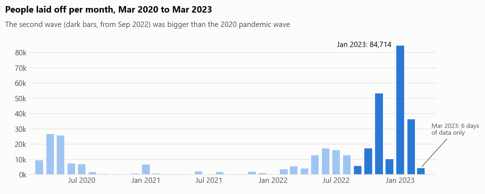
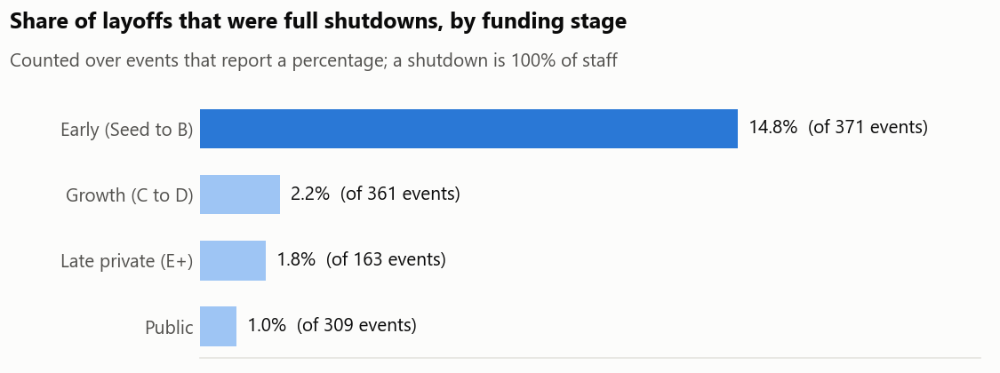

# Tech layoffs 2020–2023: cleaning and analysis in MySQL

> **In short:** Between 2020 and 2023, tech companies around the world announced thousands of layoffs. I took a public list of 2,361 of them, fixed the errors in it, and used it to answer practical questions. The clearest finding: young startups were about seven times more likely than larger companies to close down completely. In Nigeria, most layoffs happened in late 2022, and Jumia alone made up almost half of the reported total.
>
> **What it shows:** I can clean messy real-world data carefully, keep a record of every change, and turn it into plain answers.

2,361 layoff announcements from March 2020 to March 2023, cleaned in MySQL and used to answer five questions: when the wave peaked, which industries cut deepest, whether early-stage startups were more likely to close, how often companies cut twice, and what happened in Nigeria.

**Tools:** MySQL 8 (CTEs, window functions, generated columns, multi-table `UPDATE`), Python/matplotlib for the two charts.



## What I found

**1. The second wave was three times the size of the first.** From September 2022 to early March 2023, 212,744 people were laid off, against 69,769 in March to June 2020. January 2023 alone (84,714) was larger than all of 2021. The data stops on 6 March 2023, so it can't show whether the wave was ending.

**2. Retail lost the second-most jobs and ranks last on the share of its workforce cut.** Big totals in Retail and Consumer come from very large employers making small percentage cuts. Measured as people cut ÷ estimated headcount before the layoff, Travel (21.8%), Crypto (20.3%) and Fitness (20.1%) cut deepest; Retail cut 4.3%. Industry rankings built on raw totals mostly measure company size.



**3. Early-stage startups were about seven times more likely to shut down entirely.** 14.8% of Seed to Series B layoffs were 100% of staff, against 2.2% at Series C–D and 1.0% for public companies. Funding didn't guarantee survival: Britishvolt ($2.4bn raised) and Quibi ($1.8bn) both closed.

**4. Companies that cut once usually cut again within six months.** 343 of 1,916 companies had more than one round. 56% of second rounds came within 180 days of the previous one, and repeat-round companies account for 52% of everyone laid off.

**5. Nigeria's layoffs were concentrated in late 2022.** 12 of Nigeria's 15 recorded events fall between September 2022 and March 2023. Three of the six in November 2022 were crypto firms (Nestcoin, Quidax, Lazerpay), the month FTX collapsed. Jumia's 900 make up 48% of the 1,882 Nigerian layoffs with a reported number, and a third of Nigerian events (5 of 15) give no number at all, so the real total is higher.

## How the data was cleaned

`02_clean.sql` builds a typed table from the raw text and logs the row count of each step to a `cleaning_log` table:

| Step | Rows |
|---|---|
| Company names with stray spaces (trimmed before de-duplicating) | 11 |
| Exact duplicate rows removed | 5 |
| Blank industry set to NULL | 3 |
| "CryptoCurrency" / "Crypto Currency" merged into Crypto | 3 |
| "Fin-Tech" merged into Finance | 3 |
| Trailing full stop removed from country ("United States.") | 4 |
| Missing stage set to Unknown | 6 |
| Company case variants unified (ByteDance / Bytedance) | 5 |
| Location accent variants unified (Malmo / Malmö) | 2 |
| Industry filled from another row of the same company **and location** | 3 |
| Rows with no count and no percentage, flagged and kept | 361 |

Three decisions worth explaining:

- **Missing industries are filled by company and location, not company name alone.** "Bolt" is three different companies in this data, with different industries. Matching on name would copy the wrong value.
- **Rows with no headcount are flagged, not deleted.** A row with neither a count nor a percentage still records that a layoff happened. It stays in event counts and is excluded from headcount totals (`has_headcount = 0`).
- **Estimated headcount is a generated column.** `est_headcount_before = total_laid_off / percentage_laid_off` where both are reported (500 people at 5% → about 10,000 staff). That makes the industry comparison in finding 2 possible.

`03_quality_checks.sql` then tests eight rules. Six pass with zero failures. Two return one row each, both known gaps in the source that I left alone rather than guess: Blackbaud has no date, and Bally's Interactive has no industry to borrow.

## Limits of this data

- It is compiled from news reports (layoffs.fyi via Kaggle), so it over-represents US tech and companies that make the news. Africa has 30 events in total.
- 31% of rows have no layoff count and 33% no percentage. Totals are lower bounds.
- Funding stage is "Unknown" for 17% of rows, which is why that group is shown separately in `04_analysis.sql`.

## Reproduce

Requires MySQL 8 with `local_infile` enabled, run from the repository root:

```bash
mysql --local-infile=1 -u root -p < sql/01_load.sql
mysql -u root -p < sql/02_clean.sql
mysql -u root -p < sql/03_quality_checks.sql
mysql -u root -p --table < sql/04_analysis.sql
```

The full output of the last script is saved in [`results/04_analysis_output.txt`](results/04_analysis_output.txt). The charts are drawn by `charts/make_charts.py` from the two TSV files in `results/`.

```
sql/01_load.sql            raw CSV into a text-only table
sql/02_clean.sql           typed, de-duplicated, standardised table + cleaning log
sql/03_quality_checks.sql  eight rules that should pass before analysis
sql/04_analysis.sql        the five questions
data/layoffs.csv           source data
```

## Source and credit

Data: [Layoffs Dataset](https://www.kaggle.com/datasets/swaptr/layoffs-2022) by Swapnil Tripathi on Kaggle, compiled from [layoffs.fyi](https://layoffs.fyi). I first worked with this dataset in Alex Freeberg's (Alex The Analyst) MySQL bootcamp. The cleaning rules, quality checks, questions and analysis here are my own rewrite.
